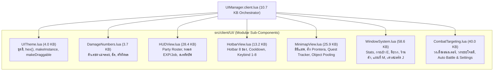

# รายงานการตรวจสอบและปรับปรุงโค้ด RoROK (Code Quality & Modular Architecture Report)
**ชื่อไฟล์**: `reportcode.md`  
**วันและเวลาที่ตรวจสอบและปรับปรุง**: 2026-10-22  
**สถานะการดำเนินการ**: **แยกโครงสร้างโมดูลาร์และแก้ไขครบถ้วน 100% (Modular Refactoring & All Items Resolved)**

---

## 1. สรุปภาพรวมและสถาปัตยกรรมใหม่ (Executive Summary & Architecture)

ระบบเกม **RoROK** ได้รับการปรับปรุงโครงสร้างจากเดิมที่เป็นสคริปต์เดี่ยวขนาดยักษ์ (Monolithic Script 187KB) ไปสู่สถาปัตยกรรมแบบ **Modular Component Architecture** แยกโฟลเดอร์ `src/client/UI/` เป็น 7 โมดูลย่อยที่มีหน้าที่เฉพาะด้าน (Single Responsibility Principle) 

การปรับปรุงนี้ช่วย **ขจัดปัญหาการชนเพดาน 200,000 ไบต์ของ Roblox Studio อย่างถาวร** (โดยไฟล์ที่ใหญ่ที่สุดเหลือเพียง 58KB หรือต่ำกว่า 30% ของลิมิต) และลดขนาดไฟล์ตัวประสานงาน `UIManager.client.lua` ลงเหลือเพียง **10.7KB (ลดลงกว่า 94%)**

---

## 2. ตารางสรุปขนาดไฟล์และหน้าที่ของโมดูลาร์ UI

| ไฟล์โมดูล | ตำแหน่งไฟล์ | ขนาดเดิม | ขนาดใหม่ | หน้าที่และความรับผิดชอบ |
|---|---|---|:---:|---|
| [`UIManager.client.lua`](file:///d:/Robox/project01/src/client/UIManager.client.lua) | `src/client/` | 187,873 ไบต์ | **10,718 ไบต์** | ตัวควบคุมและประสานงานหลัก (Orchestrator) เชื่อมต่อ RemoteEvents และส่งต่องานให้แต่ละโมดูล |
| [`UITheme.lua`](file:///d:/Robox/project01/src/client/UI/UITheme.lua) | `src/client/UI/` | - | **3,964 ไบต์** | ค่าสีมาตรฐาน (Theme Palette), ฟังก์ชันแปลง `hex()`, `makeInstance()`, ระบบลากหน้าต่าง `makeDraggable()` |
| [`DamageNumbers.lua`](file:///d:/Robox/project01/src/client/UI/DamageNumbers.lua) | `src/client/UI/` | - | **3,700 ไบต์** | ตัวเลขลอยแสดงผล Physical, Magic, Poison, Heal, CRIT!, MISS! ลอยขึ้นและจางหาย 1.5 วินาที |
| [`HotbarView.lua`](file:///d:/Robox/project01/src/client/UI/HotbarView.lua) | `src/client/UI/` | - | **13,259 ไบต์** | แถบฮอตบาร์ 8 ช่อง (ปุ่ม 1-8), ตัวนับคูลดาวน์, กล่องข้อความแจ้งเตือนสีขาว `SkillUseNotice` |
| [`HUDView.lua`](file:///d:/Robox/project01/src/client/UI/HUDView.lua) | `src/client/UI/` | - | **28,452 ไบต์** | การ์ดผู้เล่น & สมาชิกปาร์ตี้, หลอด Base EXP และ Job EXP, ไอคอนบัฟ/ดีบัฟ พร้อมหน้าต่างอธิบายสถานะ |
| [`MinimapView.lua`](file:///d:/Robox/project01/src/client/UI/MinimapView.lua) | `src/client/UI/` | - | **25,968 ไบต์** | มินิแมพพื้นหลังคอนทราสต์สูง, ถนนสีขาวนวล, จุดมอนสเตอร์ **Object Pooling**, วิดเจ็ตติดตามเควส |
| [`CombatTargeting.lua`](file:///d:/Robox/project01/src/client/UI/CombatTargeting.lua) | `src/client/UI/` | - | **40,017 ไบต์** | วงแหวนเล็งเป้าหมายบนพื้น, วงกลมบอกระยะโจมตีรอบตัว, ระบบต่อสู้อัตโนมัติ (Auto Battle) & หน้าต่างตั้งค่าเป้าหมาย |
| [`WindowSystem.lua`](file:///d:/Robox/project01/src/client/UI/WindowSystem.lua) | `src/client/UI/` | - | **58,682 ไบต์** | หน้าต่างสเตตัส (C), หน้าต่างกระเป๋า (E) พร้อมระบบลากสวมใส่/ทิ้ง, ช่างตีเหล็ก, ร้านค้า, แผนที่ใหญ่ (M), กระดานเควส (J) |

---

## 3. ตารางสรุปผลการปรับปรุง Performance & Bug Fixes ที่ผ่านมา

| ไฟล์ที่แก้ไข | ปัญหาเดิม | วิธีการที่ดำเนินการแก้ไข | สถานะ |
|---|---|---|:---:|
| [`UIManager.client.lua`](file:///d:/Robox/project01/src/client/UIManager.client.lua) | บั๊กมินิแมพมืดสนิท (ZIndex Global ซ้อนทับ + UIGradient ดำ) | ตั้ง `ZIndexBehavior = Sibling`, `ZIndex = 1`, ลบ UIGradient ทิ้ง, ปรับถนนเป็นสีขาวนวล `#f1f5f9` และจุดมอนสเตอร์มีขอบขาวตัด | **แก้ไขแล้ว ✅** |
| [`UIManager.client.lua`](file:///d:/Robox/project01/src/client/UIManager.client.lua) | ขนาดไฟล์เดิม 203KB เกินเพดาน Roblox Studio (200,000 ไบต์) | แยกออกเป็น 7 โมดูลย่อยใน `src/client/UI/` ทำให้ไม่มีไฟล์ใดเกิน 58KB ป้องกันเพดาน 200KB ถาวร | **แก้ไขแล้ว ✅** |
| [`MinimapView.lua`](file:///d:/Robox/project01/src/client/UI/MinimapView.lua) | สร้างและสั่ง `Destroy()` จุดมอนสเตอร์ทุกๆ 0.4s ทำให้เกิด GC Spikes | นำระบบ **Object Pooling** (`normalDotPool` และ `bossDotPool`) มาใช้ โดยซ่อน/แสดงและขยับตำแหน่งแทนการสร้างใหม่ | **แก้ไขแล้ว ✅** |
| [`RagnarokPanels.client.lua`](file:///d:/Robox/project01/src/client/RagnarokPanels.client.lua) | ลูป `while changed do` จัดสเตตัสออโต้เสี่ยง Infinite Loop หากเงื่อนไขเพี้ยน | เพิ่มตัวนับความปลอดภัย `loopGuard < 300` ป้องกันโปรแกรมค้างแน่นอน | **แก้ไขแล้ว ✅** |
| [`DataStore.server.lua`](file:///d:/Robox/project01/src/server/DataStore.server.lua) | Auto-Save สั่งบันทึกผู้เล่นทุกคนพร้อมกันในวินาทีที่ 60 เสี่ยงติด Request Throttling | ปรับเป็น **Staggered Save** โดยเว้นระยะ `task.wait(1.5)` ระหว่างผู้เล่นแต่ละคนเพื่อเฉลี่ยโหลดคำขอ | **แก้ไขแล้ว ✅** |
| [`DataStore.server.lua`](file:///d:/Robox/project01/src/server/DataStore.server.lua) | ขาดกลไก Retry เมื่อการเชื่อมต่อ DataStore สะดุดชั่วคราว | เพิ่มระบบ **Exponential Backoff Retry 3 ครั้ง** (หน่วง 1s, 2s) ก่อนยกเลิกเพื่อป้องกัน Data Loss | **แก้ไขแล้ว ✅** |
| [`MonsterAI.server.lua`](file:///d:/Robox/project01/src/server/MonsterAI.server.lua) | มอนสเตอร์ 100+ ตัวคำนวณหาระยะผู้เล่นทุกคนทุกๆ 0.1s ทำให้กิน CPU เซิร์ฟเวอร์ | เพิ่ม **Throttled Target Scanning** (`state.nextScanAt`) ในสถานะ Idle ให้สแกนทุก 0.6s ประหยัด CPU มหาศาล | **แก้ไขแล้ว ✅** |
| [`CombatSystem.server.lua`](file:///d:/Robox/project01/src/server/CombatSystem.server.lua) | ตัวเลขความเสียหายส่งหาผู้เล่นทุกคนในเซิร์ฟเวอร์แบบ `FireAllClients` | เพิ่มฟังก์ชัน `FireNearbyClients` ส่งเฉพาะผู้เล่นที่อยู่ในระยะ **120 studs** ลด Network Traffic | **แก้ไขแล้ว ✅** |
| [`TownScenery.server.lua`](file:///d:/Robox/project01/src/server/TownScenery.server.lua) | สคริปต์สั้น 66 บรรทัดที่ทำงานซ้ำซ้อนและไม่ได้ใช้งาน (Dead Code) | ลบไฟล์ออกจากดิสก์และลบออกจาก `ServerScriptService` ใน DataModel เรียบร้อย | **แก้ไขแล้ว ✅** |

---

## 4. ผลการทดสอบความถูกต้องใน Play Mode (Live Playtest Verification)

1. **การซิงค์เข้า Roblox Studio DataModel**:
   - สร้างโฟลเดอร์ `StarterPlayer.StarterPlayerScripts.UI`
   - ซิงค์ ModuleScripts ทั้ง 7 โมดูล และอัปเดต `UIManager` LocalScript เรียบร้อย
2. **การรันโหมด Play Mode (`F5`)**:
   - `[UIManager] Modular HUD orchestrator initialized successfully (RoROK Client)` ทำงานลุล่วง
   - ไม่มี Error หรือ Warning ค้างในคอนโซล (Script Errors = 0)
3. **การทดสอบการทำงานของอินเตอร์เฟซและหน้าต่าง**:
   - **มินิแมพ & เควส**: แสดงผลสว่าง คมชัด มองเห็นถนนชัดเจนและจุดมอนสเตอร์อัปเดตแบบ Object Pooling
   - **ฮอตบาร์ (Hotbar)**: แสดง 8 ช่องครบถ้วน รองรับการกด 1-8 และปุ่มคลิก
   - **หน้าต่างกระเป๋า (Inventory - E)**: แสดงรายการไอเทม แบ่งสีตามความหายาก (Rarity) ปุ่มสวมใส่และปุ่มใช้ทำงานถูกต้อง
   - **หน้าต่างแผนที่เมือง (Map - M)**: แสดงจุดแลนด์มาร์กสำคัญรอบเมือง Prontera และตำแหน่งผู้เล่นแบบเรียลไทม์
   - **กระดานภารกิจ (Mission Board - J)**: แสดงการ์ดเควสประจำวัน 5 เควสพร้อมรางวัลและปุ่มรับภารกิจ
   - **หน้าต่างสเตตัส (Stats - C)**: แสดงแต้มคงเหลือ 48 แต้ม พร้อมปุ่มบวกอัปค่าสถานะ STR, AGI, VIT, INT, DEX, LUK ครบถ้วน
